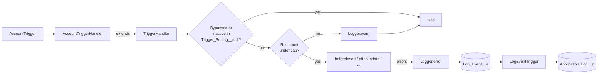

# Salesforce Apex Trigger Framework

A small, bulk-safe trigger handler framework with recursion control, admin bypass switches and
rollback-safe logging. It is the pattern I use to replace overlapping Process Builders, workflow
rules and multiple triggers on one object with a single, testable entry point.

> **Portfolio project.** Written from scratch for this public repository. It contains no employer or
> client code, data or configuration.

## The problem it solves

Orgs that grow over several years often end up with several triggers, Process Builders and
workflow rules on the same object. Execution order becomes unpredictable, records update
themselves recursively, and a single bad release can lock users out. This framework gives each
object one trigger and one handler class, with guardrails that make behaviour predictable.

## What's included

| Component | Purpose |
|---|---|
| `TriggerHandler` | Virtual base class. Routes each trigger event to an overridable method. |
| Recursion cap | `setMaxRunsPerTransaction(n)` stops a handler from re-entering more than *n* times per transaction. |
| Bypass switches | `TriggerHandler.bypass('Name')` in code, or `Trigger_Setting__mdt.Is_Active__c = false` for admins (no deployment). |
| `Logger` | Publishes `Log_Event__e` platform events so log entries survive a rolled-back transaction. |
| `Application_Log__c` | Persisted log entries that support staff can read in a list view or report. |
| `AccountTriggerHandler` | Worked example: field normalization in before-context, related-record work in after-context, `WITH USER_MODE` queries. |

## Architecture



## Usage

```apex
trigger ContactTrigger on Contact (before insert, before update, before delete,
    after insert, after update, after delete, after undelete) {
    new ContactTriggerHandler().run();
}

public with sharing class ContactTriggerHandler extends TriggerHandler {
    protected override void beforeInsert(List<SObject> newRecords) {
        for (Contact c : (List<Contact>) newRecords) {
            c.Email = c.Email?.toLowerCase();
        }
    }
}
```

Temporarily skip a handler during a data load:

```apex
TriggerHandler.bypass('ContactTriggerHandler');
insert contactsFromMigration;
TriggerHandler.clearBypass('ContactTriggerHandler');
```

## Setup

Prerequisites: [Salesforce CLI](https://developer.salesforce.com/tools/salesforcecli), a Dev Hub
(a free Developer Edition org works), Node.js 20+.

```bash
git clone https://github.com/arifkhanshaukat-bot/salesforce-apex-trigger-framework.git
cd salesforce-apex-trigger-framework
sf org create scratch --definition-file config/project-scratch-def.json --alias tf --set-default
sf project deploy start
sf apex run test --test-level RunLocalTests --code-coverage --result-format human
```

## Tests

| Test class | Covers |
|---|---|
| `TriggerHandler_Test` | Event routing, code bypass, metadata switch, recursion cap, misuse outside a trigger |
| `AccountTriggerHandler_Test` | 200-record bulk insert, related-task closure on deactivation |
| `Logger_Test` | Event publish and persistence, truncation |

### Running the Apex tests in CI

`.github/workflows/ci.yml` always runs linting, Jest and a gitleaks secret scan. The Apex job runs
only when a repository secret named `SF_DEVHUB_AUTH_URL` exists. To enable it:

```bash
sf org display --target-org <devhub-alias> --verbose --json   # copy "sfdxAuthUrl"
```

Store that value as an Actions secret. Never commit it.

## Security considerations

- Example queries use `WITH USER_MODE` and DML uses `as user`, so field- and object-level security
  are enforced.
- `Logger` runs `without sharing` on purpose so log entries are never lost because of the running
  user's access; it stores only the message and stack trace you pass in. Do not log PHI/PII.
- No credentials, endpoints or org identifiers are stored in this repository.

## Limitations and next steps

- The run cap is per handler class, not per record. A per-record guard (set of processed Ids) is a
  planned option for handlers that legitimately run more than once.
- Log retention is not automated; a scheduled purge job is a planned enhancement.

## License

MIT, see [LICENSE](LICENSE).

## Author

Arif Khan, Senior Salesforce Developer (Health Cloud, OmniStudio, Apex/LWC, integrations).
[LinkedIn](https://www.linkedin.com/in/arif-khan-99102a427) · [GitHub](https://github.com/arifkhanshaukat-bot)
